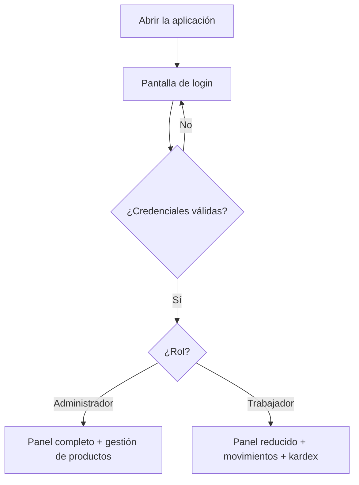
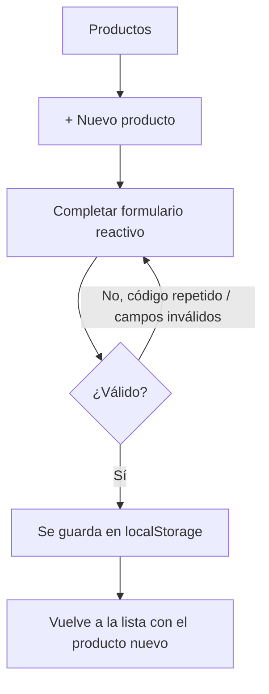
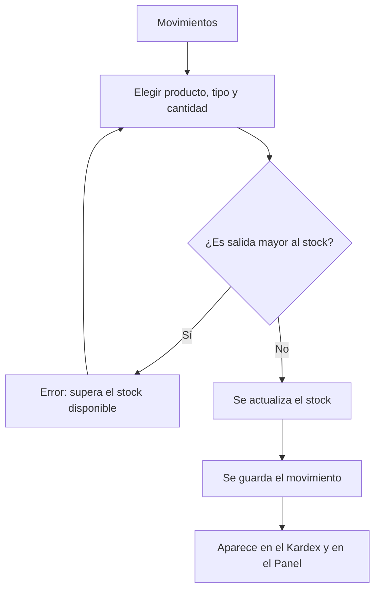
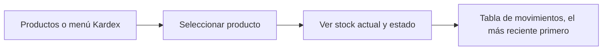

# Diseño de la solución

## 1. Definición del problema

**Situación:** una tienda de útiles escolares en crecimiento lleva su inventario en hojas de cálculo y cuadernos. Esto genera:

| Problema actual | Cómo lo resuelve la aplicación |
|---|---|
| No se sabe cuánto stock real hay de cada producto | Stock actualizado automáticamente con cada movimiento |
| Se descubre tarde que un producto se agotó | Alertas de stock bajo y agotado (panel, filas resaltadas y estado) |
| No hay historial de qué entró y qué salió | Kardex por producto con fecha, tipo, cantidad y motivo |
| Se registran salidas mayores al stock por error | Validación que impide salidas superiores al stock disponible |
| Códigos de producto repetidos | Validador personalizado de código único |
| Cualquier persona puede cambiar precios o borrar productos | Roles: solo el administrador gestiona el catálogo |

**Usuarios y necesidades**

| Usuario | Necesidades |
|---|---|
| **Administrador** (dueño / encargado) | Gestionar el catálogo (crear, editar, eliminar), ver valor del inventario, controlar alertas, revisar el kardex, registrar movimientos |
| **Trabajador** (almacén / ventas) | Consultar productos y stock, registrar entradas y salidas, consultar el kardex |

### Permisos por rol

| Funcionalidad | Administrador | Trabajador |
|---|:---:|:---:|
| Iniciar sesión | ✅ | ✅ |
| Ver panel con alertas y últimos movimientos | ✅ | ✅ |
| Ver valor total del inventario | ✅ | ❌ |
| Listar y buscar productos | ✅ | ✅ |
| Crear / editar / eliminar productos | ✅ | ❌ |
| Registrar entradas y salidas | ✅ | ✅ |
| Consultar kardex | ✅ | ✅ |

La restricción se aplica en **dos niveles**: se ocultan los botones en la interfaz y además la ruta está protegida con `rolGuard`, por lo que escribir `/productos/nuevo` en la URL como trabajador redirige al panel.

## 2. Flujos de usuario

### Inicio de sesión y roles


### Registro de un producto (solo administrador)


### Registro de un movimiento (admin y trabajador)


### Consulta del kardex (admin y trabajador)


## 3. Bocetos de las pantallas principales

### Login
```
+--------------------------------------+
|  Iniciar sesión                      |
|  Sistema de inventario - Útiles      |
|                                      |
|  Usuario     [____________________]  |
|  Contraseña  [____________________]  |
|                                      |
|  [ Ingresar ]                        |
|  Demo admin / trabajador (ver README)|
+--------------------------------------+
```

### Panel de control
```
+---------------------------------------------------------------+
| 📦 Inventario Escolar   Panel  Productos  Movimientos  Kardex  Salir |
+---------------------------------------------------------------+
|  Panel de control                                             |
|  +-----------+  +--------------------+  +-----------------+   |
|  | Productos |  | Valor inventario*  |  | Alertas stock   |   |
|  |     4     |  |    S/ 1,234.00     |  |       2         |   |
|  +-----------+  +--------------------+  +-----------------+   |
|  * solo visible para el administrador                         |
|  Productos con alerta   [tabla: producto | stock | mín | estado] |
|  Últimos movimientos    [tabla: fecha | producto | tipo | cant] |
+---------------------------------------------------------------+
```

### Lista de productos
```
|  Productos                                                    |
|  [ Buscar por código o nombre...        ]  [+ Nuevo producto]*|
|  +--------+-----------+-----------+--------+-------+--------+--------------------+
|  | Código | Nombre    | Categoría | Precio | Stock | Estado | Acciones           |
|  | LAP-001| Lapicero..| Lapiceros | S/9.90 | 8     | Bajo   | Editar* Kardex Eliminar* |
|  +--------+-----------+-----------+--------+-------+--------+--------------------+
|  * solo administrador. Fila amarilla = stock bajo, roja = agotado |
```

### Formulario de producto
```
|  Nuevo producto                       |
|  Código [______]  Nombre [__________] |
|  Categoría [Cuadernos v]              |
|  Precio [___]  Stock [___]  Mínimo [___] |
|  (mensajes de error bajo cada campo)  |
|  [Registrar producto] [Cancelar]      |
```

### Registrar movimiento
```
|  Producto [-- Seleccione -- v]   Stock actual: 8 |
|  Tipo [Entrada v]   Cantidad [1]                 |
|  Motivo [Compra a proveedor, venta, merma...]    |
|  [Registrar] [Ver kardex]                        |
```

### Kardex
```
|  Producto [LAP-001 - Lapicero azul v]            |
|  Stock actual: 8 · Estado: Stock bajo            |
|  | Fecha            | Tipo    | Cant | Motivo   | |
|  | 04/11/2026 10:30 | Entrada | +20  | Compra   | |
```

> Versión móvil: el menú se colapsa en un botón ☰, los formularios pasan a una sola columna y las tablas tienen desplazamiento horizontal.
